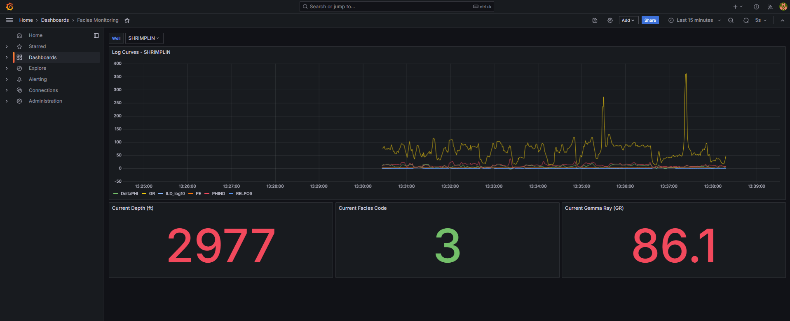
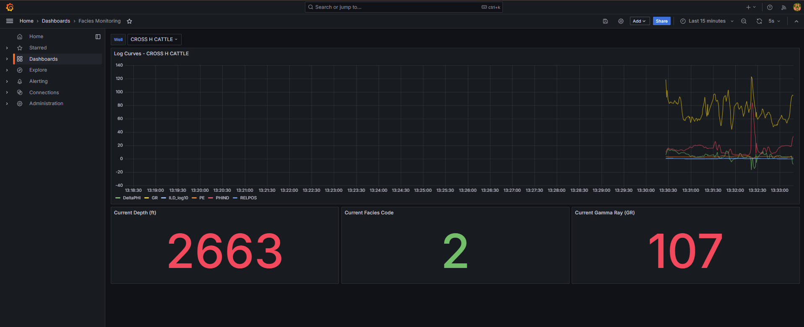
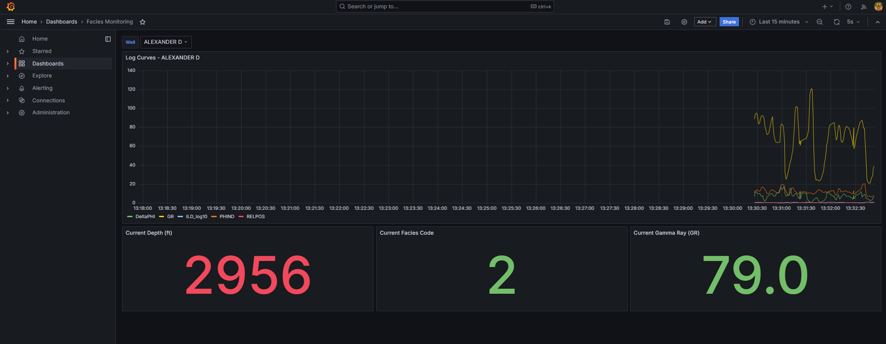
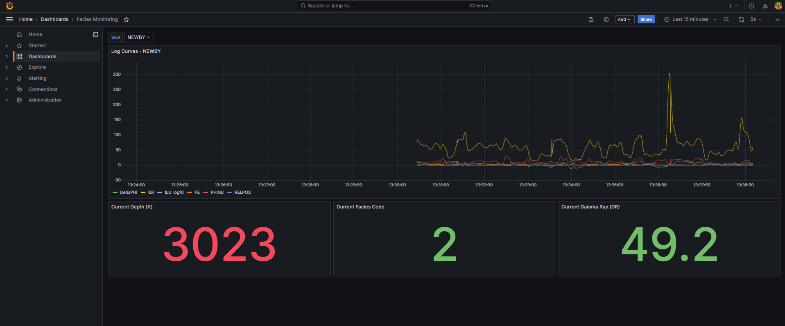
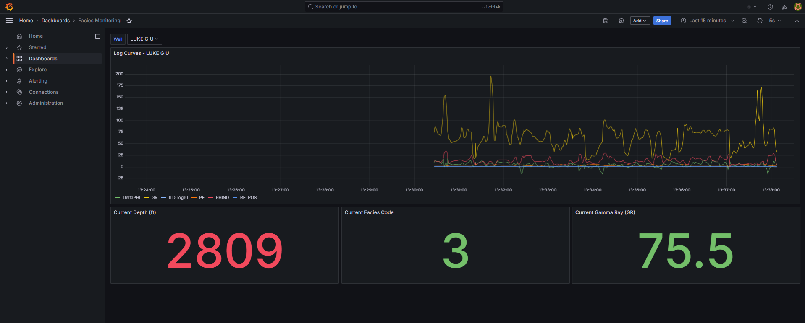
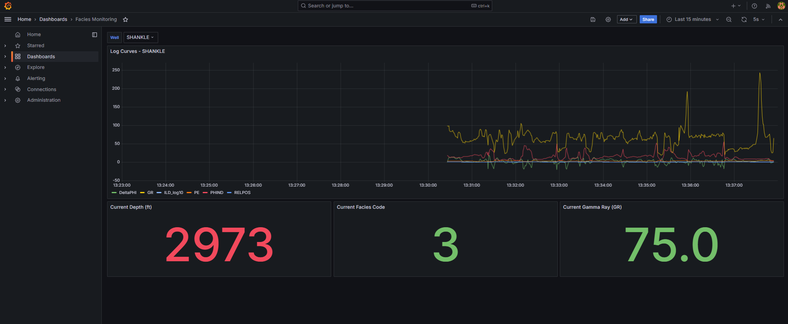
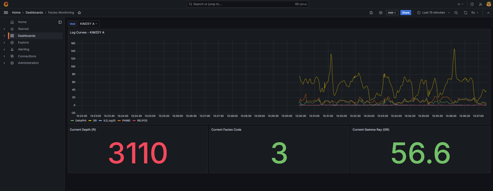
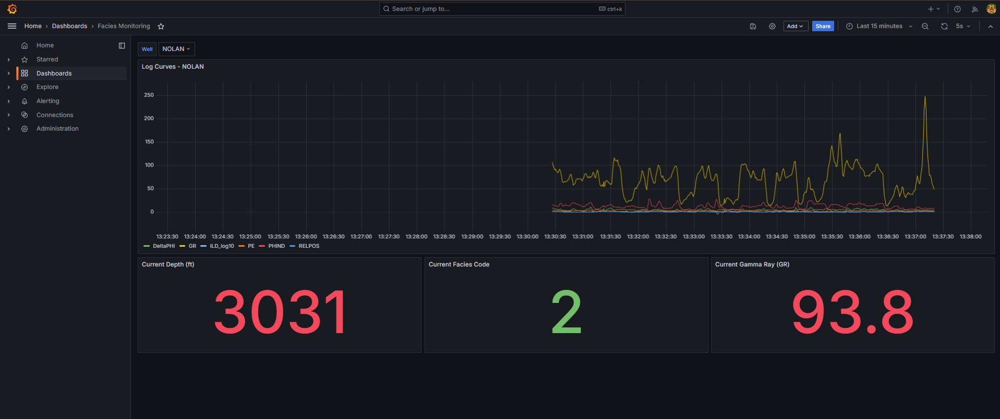
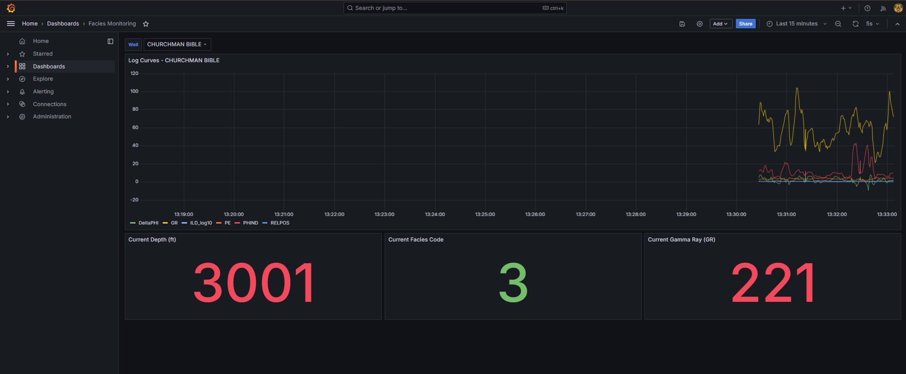
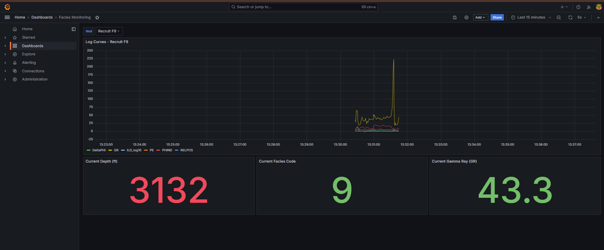

# Facies Monitoring Dashboard

A real-time monitoring dashboard for well log facies data, built as a full
data infrastructure pipeline — from simulated sensor ingestion (MQTT)
through durable stream processing (Kafka) to time-series storage and
visualization (InfluxDB + Grafana). Historical well log data is replayed
row-by-row to simulate a live-streaming logging operation.

## Overview

This project was built as a hands-on way to relearn Data Infrastructure
Processing concepts — with an eye toward SCADA/OT engineering applications
in the oil & gas industry. Rather than a single ingestion-to-storage
shortcut, it deliberately goes through a full multi-stage pipeline:

```
[Python Replayer] --> [MQTT (Mosquitto)] --> [Bridge] --> [Kafka] --> [Telegraf] --> [InfluxDB] --> [Grafana]
```

| Stage      | Role                                                                 |
|------------|------------------------------------------------------------------------|
| Replayer   | Reads the CSV dataset, publishes each row to MQTT (one topic per well) |
| Mosquitto  | MQTT broker — lightweight, IoT-style ingestion                        |
| Bridge     | Subscribes to all MQTT topics, republishes to a single Kafka topic     |
| Kafka      | Durable message streaming, auto-partitioned by well via message key    |
| Telegraf   | Consumes from Kafka, writes to InfluxDB                                |
| InfluxDB   | Time-series database                                                    |
| Grafana    | Dashboard with multi-well filtering                                     |

Everything runs locally via Docker Compose, with Grafana's datasource and
dashboard fully auto-provisioned from version-controlled config files —
no manual UI setup required after `docker compose up`.

## Demo

| SHRIMPLIN | CROSS H CATTLE |
|---|---|
|  |  |

| ALEXANDER D | NEWBY |
|---|---|
|  |  |

| LUKE G U | SHANKLE |
|---|---|
|  |  |

| KIMZEY A | NOLAN |
|---|---|
|  |  |

| CHURCHMAN BIBLE | Recruit F9 |
|---|---|
|  |  |

## Understanding the Dashboard

**Well dropdown** — selects which well(s) to display. Supports multi-select
and an "All" option, for comparing several wells on the same chart.

**Log Curves panel** — a time series chart of six wireline log
measurements as the well's data replays:

| Curve       | Meaning                                                              |
|-------------|--------------------------------------------------------------------------|
| GR          | Gamma Ray — natural radioactivity of the rock                            |
| ILD_log10   | Resistivity (log10 scale) — how well the rock resists electric current    |
| DeltaPHI    | Porosity index (neutron-density porosity difference)                      |
| PHIND       | Average neutron-density porosity                                          |
| PE          | Photoelectric effect — helps distinguish rock/mineral type. ~22% of rows have no PE reading, shown as gaps in the line |
| RELPOS      | Relative position within the facies unit (0 = top, 1 = bottom)             |

The X-axis reflects replay time (when the point arrived in InfluxDB), not
an original logging timestamp — the source dataset only has depth, not
time.

**Stat panels** — most recent `Depth`, `Facies Code` (see reference table
below), and `GR` reading for the selected well(s). With multiple wells
selected, each panel shows one value per well for side-by-side comparison.

## Dataset

- **Source:** [SEG 2016 Machine Learning Contest](https://github.com/seg/2016-ml-contest), originally from the Council Grove gas reservoir, Kansas (Bohling & Dubois, 2003; Dubois et al., 2007)
- **Size:** 4,149 rows across 10 wells, sampled at half-foot depth intervals
- **License note:** stated as proprietary by SEG, shared specifically for this learning/contest context — not redistributed here

### Facies Code Reference

| Code | Abbreviation | Full Name                              |
|------|--------------|------------------------------------------|
| 1    | SS           | Nonmarine sandstone                       |
| 2    | CSiS         | Nonmarine coarse siltstone                |
| 3    | FSiS         | Nonmarine fine siltstone                  |
| 4    | SiSh         | Marine siltstone and shale                |
| 5    | MS           | Mudstone (limestone)                      |
| 6    | WS           | Wackestone (limestone)                    |
| 7    | D            | Dolomite                                  |
| 8    | PS           | Packstone-grainstone (limestone)          |
| 9    | BS           | Phylloid-algal bafflestone (limestone)    |

## Key Design Decisions

- **All 10 wells included**, including `Recruit F9`, which has
  significantly fewer rows (80) than the other 9 wells.
- **Missing `PE` values (~22% of rows)** are sent as `null` rather than
  dropped, preserving the real sensor-gap condition of the source data.
- **MQTT: one topic per well** (`facies/welllog/<WELL_NAME>`) — a
  lightweight, granular pub/sub pattern suited to IoT-style ingestion.
- **Kafka: a single topic** (`facies-welllog`) with the well name as the
  message key, letting Kafka auto-partition by well. This better reflects
  Kafka best practice — topics carry more overhead than MQTT topics, and
  partitions are the preferred way to parallelize within one topic.
- **Parallel replay**: all 10 wells replay simultaneously, each in its own
  thread, ordered by ascending depth. Each well checkpoints its own
  progress independently, so replay can be stopped and resumed without
  starting over.
- **Single-broker Kafka gotcha**: required
  `offsets.topic.replication.factor=1`, since the internal
  `__consumer_offsets` topic defaults to a replication factor of 3, which
  fails silently with only one broker.
- **Dual Kafka listeners**: `PLAINTEXT` (`kafka:9092`) for in-network
  container communication, and `EXTERNAL` (`localhost:9094`) for access
  from the host machine — Kafka's advertised hostname otherwise only
  resolves inside the Docker network.

## Tech Stack

- **Messaging:** Eclipse Mosquitto (MQTT), Apache Kafka (KRaft mode, no Zookeeper)
- **Processing:** Telegraf
- **Storage:** InfluxDB v2 (time-series)
- **Visualization:** Grafana (config-provisioned datasource + dashboard)
- **Scripting:** Python (`paho-mqtt`, `kafka-python`, `pandas`)
- **Orchestration:** Docker Compose

## Project Structure

```
facies-monitoring/
├── documentation/                  # dashboard screenshots, this write-up
├── grafana/
│   └── provisioning/
│       ├── datasources/influxdb.yml
│       └── dashboards/
│           ├── provider.yml
│           └── facies-monitoring.json
├── mosquitto/
│   └── config/mosquitto.conf
├── telegraf/
│   └── telegraf.conf
├── scripts/
│   ├── explore_data.py             # dataset exploration
│   ├── replayer.py                 # CSV -> MQTT (per well, checkpoint resume)
│   ├── bridge.py                   # MQTT -> Kafka
│   └── checkpoints/                # replay progress state (gitignored)
├── data/
│   └── raw/facies_vectors.csv      # dataset
├── docker-compose.yml
├── .env.example
└── README.md
```

## Installation

**Prerequisites:** Docker Desktop, Python 3.x

```bash
pip install pandas paho-mqtt kafka-python
```

## Usage

**1. Set up environment variables:**
```bash
cp .env.example .env
```

**2. Start the infrastructure stack:**
```bash
docker compose up -d
docker compose ps
```
Wait ~15 seconds for InfluxDB and Kafka to finish initializing.

**3. Create the Kafka topic** (once, or again after `docker compose down -v`):
```bash
docker exec -it facies-kafka /opt/kafka/bin/kafka-topics.sh --create \
  --topic facies-welllog --bootstrap-server localhost:9092 \
  --partitions 3 --replication-factor 1
```

**4. Start the MQTT-to-Kafka bridge** (separate terminal, leave running):
```bash
cd scripts
python bridge.py
```

**5. Start the replayer** (separate terminal):
```bash
python replayer.py --data ../data/raw/facies_vectors.csv --reset
```
Use `--reset` to replay from the start, or omit it to resume from the last
checkpoint. Use `--interval <seconds>` to change replay speed (default: 1
second per row, per well).

**6. Open the dashboard:**

Go to **http://localhost:3000**, log in with the credentials from `.env`.
The "Facies Monitoring" dashboard is auto-provisioned — pick one, several,
or all wells from the **Well** dropdown.

### Verifying each stage independently

```bash
# MQTT
docker exec -it facies-mosquitto mosquitto_sub -t "facies/welllog/#" -v

# Kafka
docker exec -it facies-kafka /opt/kafka/bin/kafka-console-consumer.sh \
  --topic facies-welllog --bootstrap-server localhost:9092 \
  --property print.key=true --from-beginning

# InfluxDB
docker exec -it facies-influxdb influx query \
  'from(bucket:"facies-bucket") |> range(start: -1h) |> limit(n:5)' \
  --org facies-org --token <YOUR_TOKEN_FROM_.env>
```

### Resetting everything

```bash
docker compose down -v
docker compose up -d
```
Then repeat steps 3–5 above.

## Limitations & Future Work

- Timestamps reflect replay/ingestion time, not original logging time —
  this dataset has no time axis of its own, only depth.
- Kafka and Mosquitto run as single-node/single-broker setups; not
  configured for production-grade durability or clustering.
- Potential extensions: a facies classification model trained on this same
  dataset, with predictions streamed back into the same dashboard;
  migrating the stack to Kubernetes; swapping components (e.g. TimescaleDB,
  Node-RED, Pulsar) to compare trade-offs.

## Contribution

Feel free to use, modify, or build on this project for learning or
experiments. Issues and pull requests are welcome.